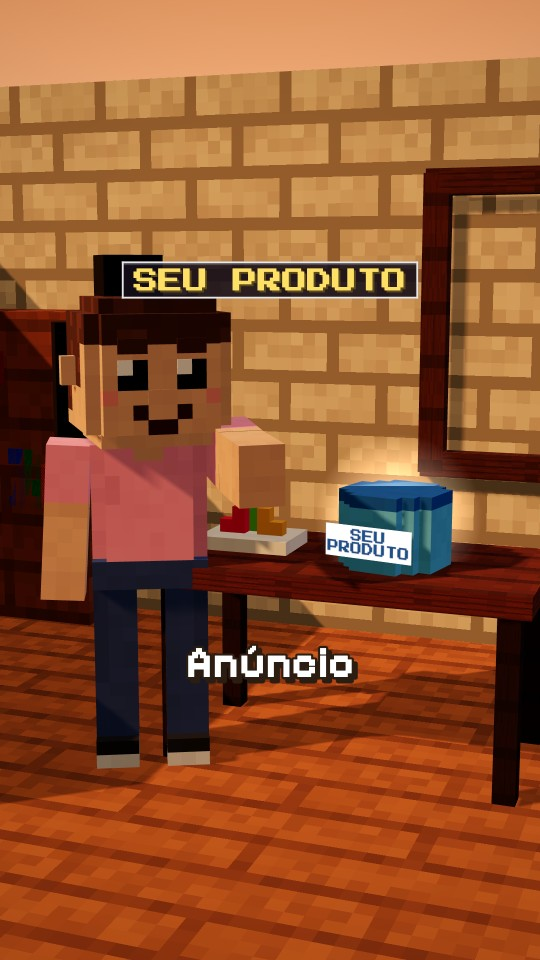

# Kit 3D: vídeos verticais em 3D com o Claude

Skills (`SKILL.md`) e arquivos separados por tipo pra fazer vídeos verticais em 3D (Shorts, Reels, TikTok) com o Claude:
**o estilo Quadradinhos**, **46 efeitos sonoros** e **10 trilhas** próprias.

Em vez de um zip de 3 GB, cada coisa fica na sua pasta e é baixada **só quando precisa**:
o motor tem uns 4 MB, cada estilo uns 2 a 3 MB, e os sons vêm um por um conforme a cena usa.

## Os estilos

| Estilo | Boneco | Cena |
|---|---|---|
| **1. Quadradinhos** (`quadradinhos`)<br>Mundo de jogo de blocos: o boneco, as árvores, o chão e os objetos são montados com quadradinhos.<br><br>Peso 75/100 · [▶ cena](kit/biblioteca/estilos/quadradinhos/cena.jpg) · [skill](skills/video-3d-quadradinhos/SKILL.md) |  |  |

## Como usar

### Opção 1: skill (recomendado)

Baixe **só a SKILL.md** do estilo que quiser (ou a `video-3d`, que ajuda a escolher) e instale no Claude:

- **Claude Code:** salve em `~/.claude/skills/<nome-da-skill>/SKILL.md`.
- **App do Claude:** em Configurações → Capacidades → Skills, envie a pasta da skill compactada.

Depois é só pedir: *"faz um vídeo 3D no estilo quadradinhos sobre como funciona uma ponte"*.
A skill baixa o motor + o estilo e segue o manual do kit (`kit/CLAUDE.md`).

| Skill | Pra quê |
|---|---|
| [`video-3d`](skills/video-3d/SKILL.md) | escolhe o estilo com a pessoa e instala só ele |
| [`criativo-video-reels`](skills/criativo-video-reels/SKILL.md) | anúncio curto pra Reels (problema-solução), do roteiro ao vídeo, com trilhas e efeitos próprios |
| [`video-3d-quadradinhos`](skills/video-3d-quadradinhos/SKILL.md) | estilo Quadradinhos |
| [`sons-3d`](skills/sons-3d/SKILL.md) | procurar e baixar efeitos sonoros e trilhas soltos, pra qualquer projeto |

### Opção 2: `baixar.py` (só Python, nada pra instalar)

```bash
python3 -c "import urllib.request as u; u.urlretrieve('https://raw.githubusercontent.com/douglasdf99/kit-3d-skills/main/kit/sistema/ferramentas/baixar.py', 'baixar.py')"
python3 baixar.py lista                         # todos os pacotes, com tamanho
python3 baixar.py estilo:quadradinhos               # motor + um estilo (o núcleo vem junto na 1ª vez)
python3 baixar.py efeitos:veiculos              # uma categoria de sons
python3 baixar.py efeito:vaca_mugindo           # um som só
python3 baixar.py video "Meus Videos/ponte"     # só o que a cena desse vídeo usa
```

No Windows o comando é `python`. As ferramentas do kit (`fazer_tudo.py`, `montar_audio.py`, `novo_video.py`…) também
chamam o `baixar.py` sozinhas quando falta um estilo, efeito, trilha ou objeto 3D.

### Opção 3: git sparse-checkout

```bash
git clone --filter=blob:none --sparse https://github.com/douglasdf99/kit-3d-skills.git
cd kit-3d-skills
git sparse-checkout set kit/sistema kit/config kit/biblioteca/estilos/quadradinhos kit/biblioteca/efeitos/skill
```

## Pacotes

| Pacote | Tamanho | O que tem |
|---|---|---|
| `nucleo` | 3.6 MB | motor 3D, ferramentas, instruções, catálogos de sons e estilos |
| `estilo:quadradinhos` | 0.3 MB | Quadradinhos |
| `musicas` / `musica:<id>` | 9.9 MB | 10 trilhas instrumentais (ou uma só) |
| `objetos:praia` / `objetos:montanha` | 38.2 / 21.4 MB | objetos 3D (GLB) prontos |
| `tudo` | 74 MB | o kit inteiro |

### Efeitos sonoros

| Pacote | Sons | Tamanho | O que tem |
|---|---|---|---|
| `efeitos:skill` | 46 | 1.0 MB | efeitos próprios, todos no mesmo volume (gancho, problema, transição, produto, CTA, videogame) |

Lista de todos os sons, com descrição: [`kit/biblioteca/efeitos/efeitos.md`](kit/biblioteca/efeitos/efeitos.md).

## O que o kit precisa no computador

Python 3 com NumPy, Node.js, FFmpeg e Google Chrome (a skill e o `kit/CLAUDE.md` conduzem a instalação).
Pra gerar narração nova: uma conta e uma chave próprias da ElevenLabs, guardadas só em `kit/config/chave_elevenlabs.txt`
(esse arquivo nunca vai pro repositório).

## Licenças e avisos

- Motor: [three.js](kit/sistema/motor/vendor/LICENSE-three.txt) (MIT) e [mp4-muxer](kit/sistema/motor/vendor/LICENSE-mp4-muxer.txt) (MIT).
- Fontes: 13 famílias OFL-1.1 e 3 Apache-2.0 ([avisos](kit/sistema/motor/fontes/)).
- **Áudios:** a origem e os direitos de redistribuição de cada efeito e trilha ainda estão sendo conferidos
  ([detalhes](kit/LICENCAS-E-ORIGENS-A-CONFERIR.txt)). Confira antes de uso comercial.

## Manutenção do repositório

Mudou algum arquivo em `kit/`? Rode da raiz:

```bash
python scripts/gerar_catalogo.py
python scripts/gerar_docs.py
```

O primeiro atualiza `kit/sistema/catalogo.json` (a lista que o `baixar.py` usa); o segundo refaz as skills e este README.
O nome do repositório fica em `kit/sistema/origem.json`.
