# Kit 3D: vídeos verticais em 3D com o Claude

Skills (`SKILL.md`) e arquivos separados por tipo pra fazer vídeos verticais em 3D (Shorts, Reels, TikTok) com o Claude:
**7 estilos visuais**, **817 efeitos sonoros** em 24 categorias e **30 trilhas**.

Em vez de um zip de 3 GB, cada coisa fica na sua pasta e é baixada **só quando precisa**:
o motor tem uns 4 MB, cada estilo uns 2 a 3 MB, e os sons vêm um por um conforme a cena usa.

## Os estilos

| Estilo | Boneco | Cena |
|---|---|---|
| **1. Padrão** (`padrao`)<br>O visual da série Desmontando o Mundo: 3D low-poly colorido, casa em corte, quintal com grama e cerca, céu com nuvens.<br><br>Peso 60/100 · [▶ demo de 10 s](kit/biblioteca/estilos/padrao/demo.mp4) · [skill](skills/video-3d-padrao/SKILL.md) | 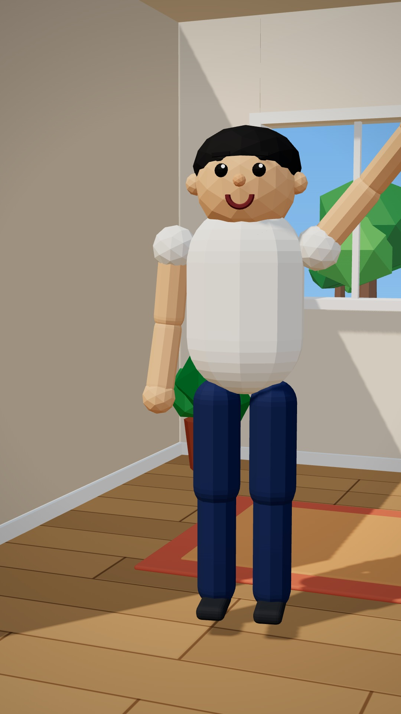 | 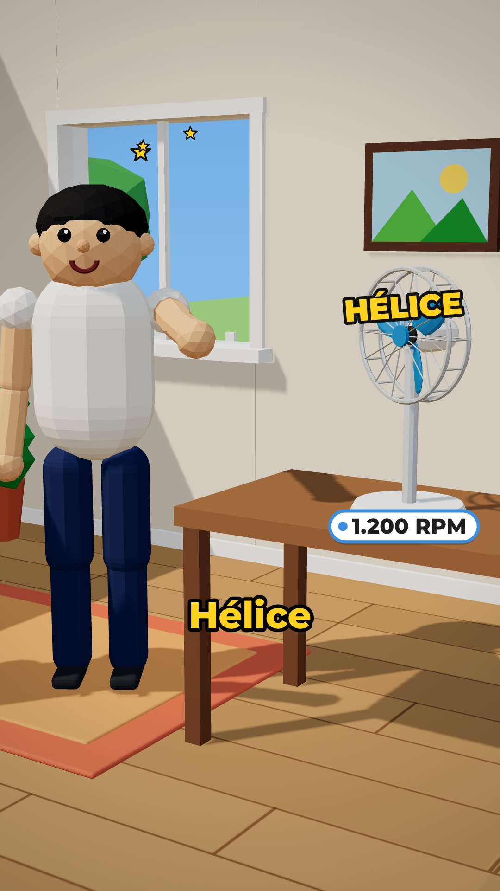 |
| **2. Ilustrado 2D** (`ilustrado`)<br>Desenho plano visto de lado, como animação de explicação: cores chapadas (petróleo, mostarda, creme, lilás), pôr do sol, prédios em corte, calçada de ondinhas.<br><br>Peso 70/100 · [▶ demo de 10 s](kit/biblioteca/estilos/ilustrado/demo.mp4) · [skill](skills/video-3d-ilustrado/SKILL.md) | 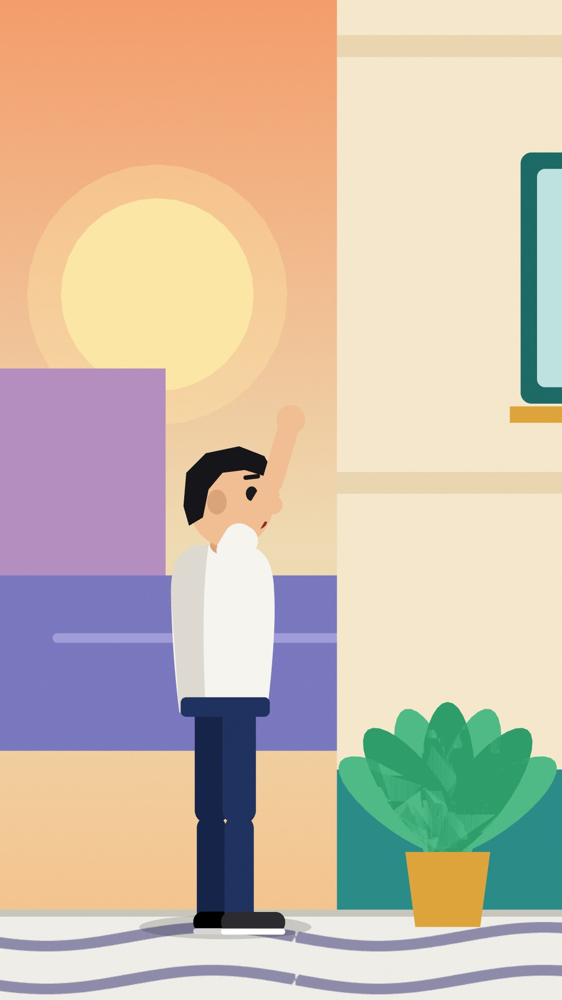 | 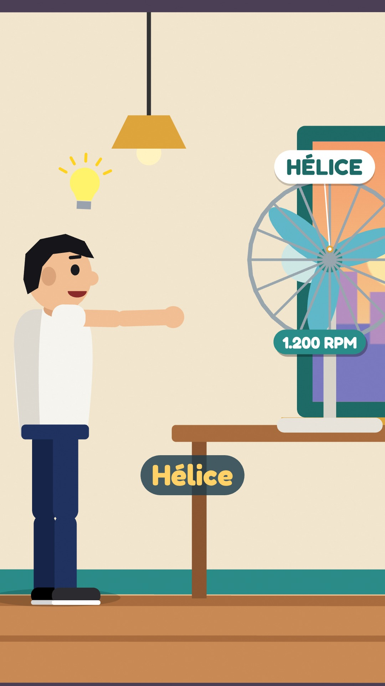 |
| **3. Cubinhos** (`cubinhos`)<br>Mundo de jogo de blocos: o boneco, as árvores, o chão e os objetos são montados com cubinhos.<br><br>Peso 75/100 · [▶ demo de 10 s](kit/biblioteca/estilos/cubinhos/demo.mp4) · [skill](skills/video-3d-cubinhos/SKILL.md) | 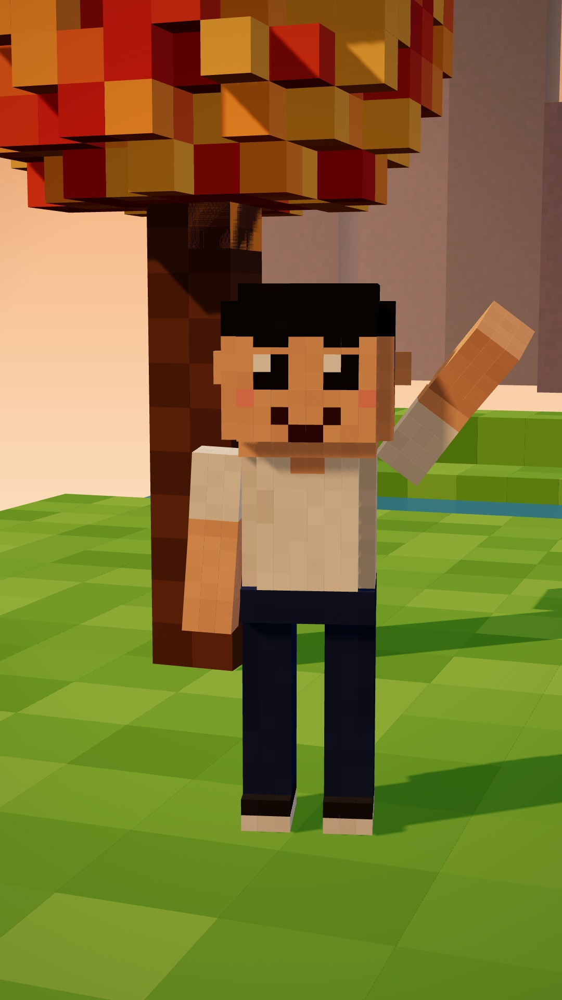 | 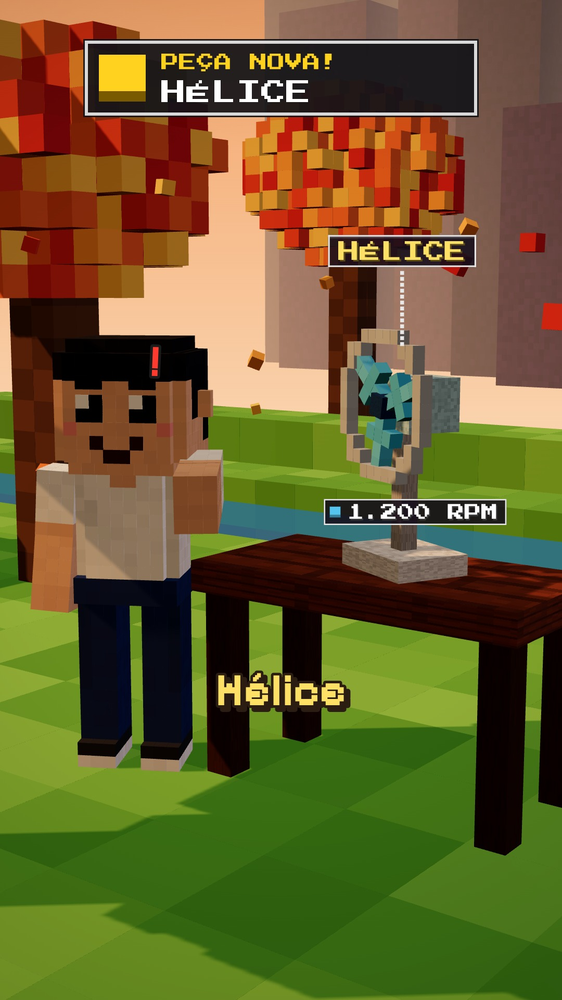 |
| **4. Brinquedo** (`brinquedo`)<br>Bonequinhos 3D lisinhos e brilhantes, cabeçudos e de olhos grandes, como brinquedos de plástico, num cenário mais realista: terra com pedrinhas, plantas, cerca de arame, trilho, morros ao longe.<br><br>Peso 55/100 · [▶ demo de 10 s](kit/biblioteca/estilos/brinquedo/demo.mp4) · [skill](skills/video-3d-brinquedo/SKILL.md) | 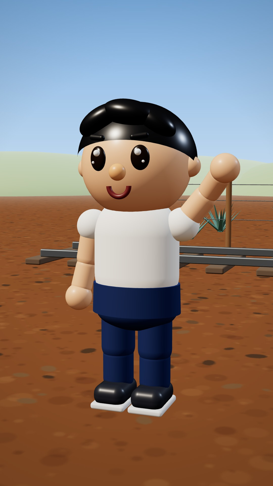 | 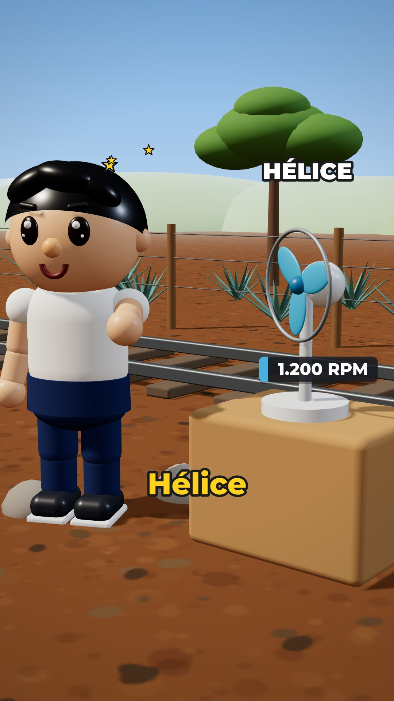 |
| **5. Simples** (`simples`)<br>3D bem básico e colorido, estilo vídeo "E SE…?": bonequinhos de cápsula com cabeça redonda grande e olhinhos de bolinha, praça clara, árvores de bolinha, céu azul limpo.<br><br>Peso 35/100 · [▶ demo de 10 s](kit/biblioteca/estilos/simples/demo.mp4) · [skill](skills/video-3d-simples/SKILL.md) | 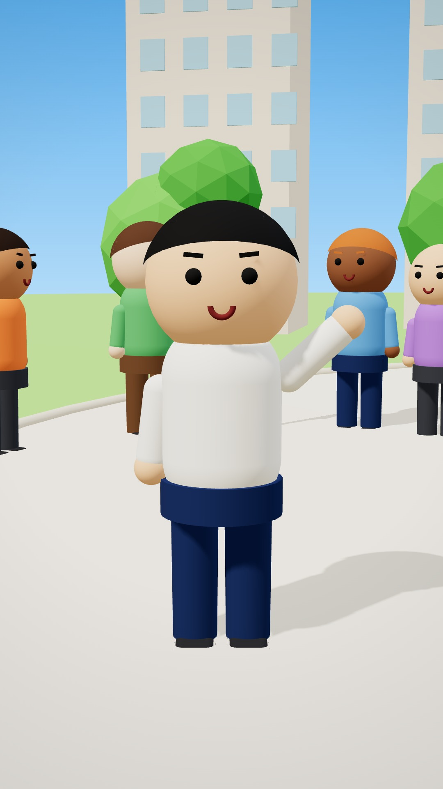 | 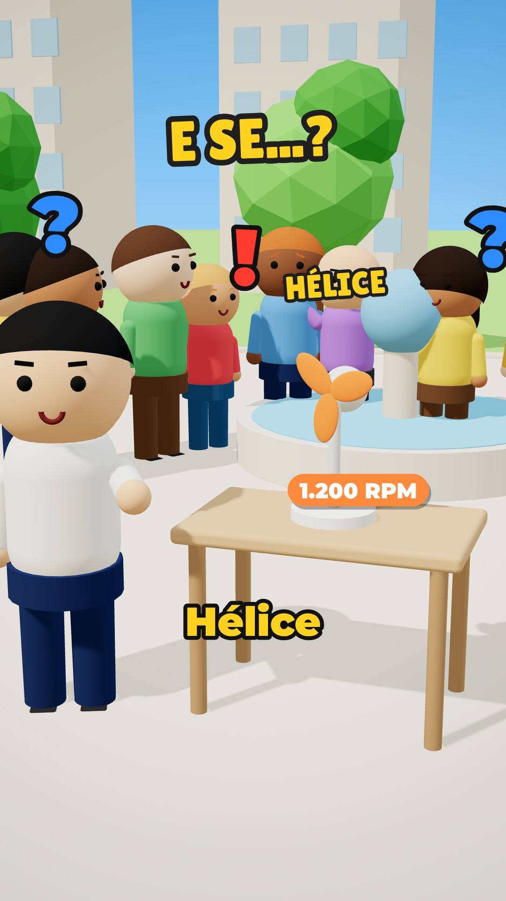 |
| **6. Desenho** (`desenho`)<br>3D com cara de desenho animado japonês: sombra em tons chapados, contorno preto em tudo, olhos grandes com brilho, cabelo espetado, cores fortes e lugares internos bem iluminados (ginásio, sala de aula, quarto).<br><br>Peso 60/100 · [▶ demo de 10 s](kit/biblioteca/estilos/desenho/demo.mp4) · [skill](skills/video-3d-desenho/SKILL.md) | 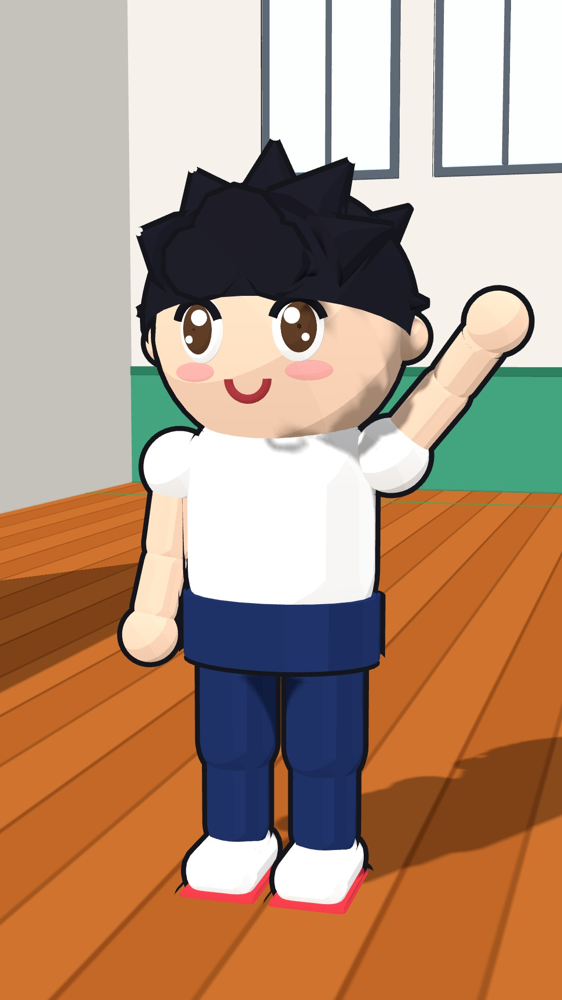 | 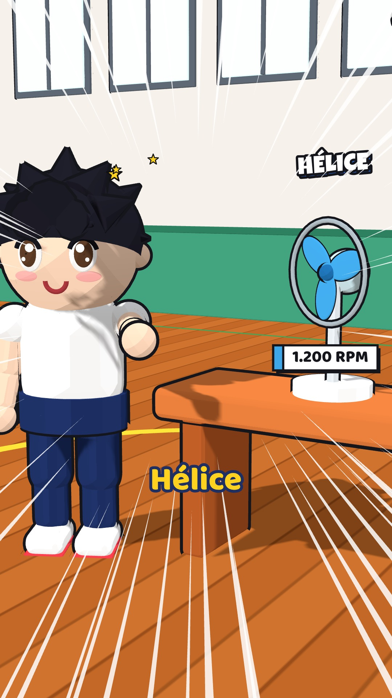 |
| **7. Avatar de jogo** (`avatar`)<br>Bonequinho de blocos de plástico, como avatar de jogo online: cabeça quadradinha com rosto desenhado, braços e pernas retos, mundo de blocos lisos e paredes de tijolo de textura simples.<br><br>Peso 45/100 · [▶ demo de 10 s](kit/biblioteca/estilos/avatar/demo.mp4) · [skill](skills/video-3d-avatar/SKILL.md) | 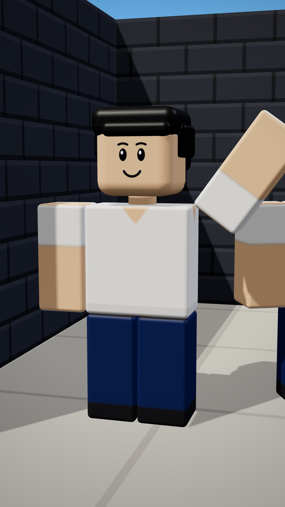 | 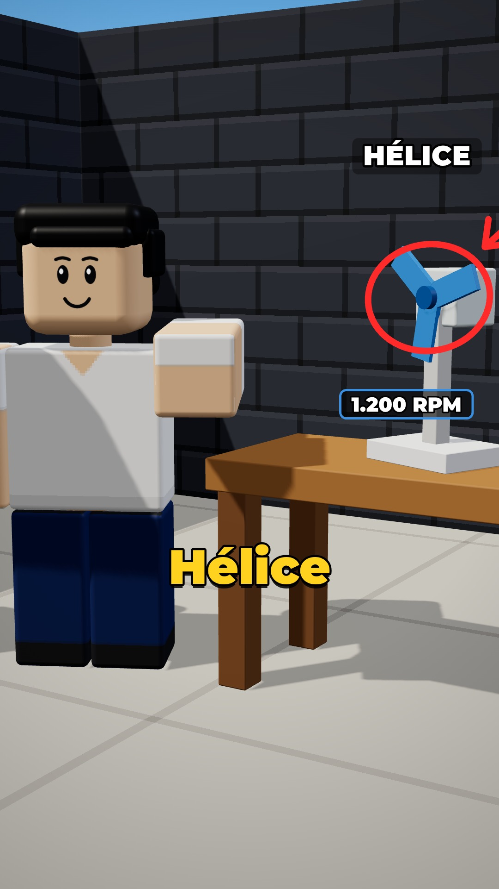 |

## Como usar

### Opção 1: skill (recomendado)

Baixe **só a SKILL.md** do estilo que quiser (ou a `video-3d`, que ajuda a escolher) e instale no Claude:

- **Claude Code:** salve em `~/.claude/skills/<nome-da-skill>/SKILL.md`.
- **App do Claude:** em Configurações → Capacidades → Skills, envie a pasta da skill compactada.

Depois é só pedir: *"faz um vídeo 3D no estilo cubinhos sobre como funciona uma ponte"*.
A skill baixa o motor + o estilo e segue o manual do kit (`kit/CLAUDE.md`).

| Skill | Pra quê |
|---|---|
| [`video-3d`](skills/video-3d/SKILL.md) | escolhe o estilo com a pessoa e instala só ele |
| [`video-3d-padrao`](skills/video-3d-padrao/SKILL.md) | estilo Padrão |
| [`video-3d-ilustrado`](skills/video-3d-ilustrado/SKILL.md) | estilo Ilustrado 2D |
| [`video-3d-cubinhos`](skills/video-3d-cubinhos/SKILL.md) | estilo Cubinhos |
| [`video-3d-brinquedo`](skills/video-3d-brinquedo/SKILL.md) | estilo Brinquedo |
| [`video-3d-simples`](skills/video-3d-simples/SKILL.md) | estilo Simples |
| [`video-3d-desenho`](skills/video-3d-desenho/SKILL.md) | estilo Desenho |
| [`video-3d-avatar`](skills/video-3d-avatar/SKILL.md) | estilo Avatar de jogo |
| [`sons-3d`](skills/sons-3d/SKILL.md) | procurar e baixar efeitos sonoros e trilhas soltos, pra qualquer projeto |

### Opção 2: `baixar.py` (só Python, nada pra instalar)

```bash
python3 -c "import urllib.request as u; u.urlretrieve('https://raw.githubusercontent.com/douglasdf99/kit-3d-skills/main/kit/sistema/ferramentas/baixar.py', 'baixar.py')"
python3 baixar.py lista                         # todos os pacotes, com tamanho
python3 baixar.py estilo:cubinhos               # motor + um estilo (o núcleo vem junto na 1ª vez)
python3 baixar.py efeitos:veiculos              # uma categoria de sons
python3 baixar.py efeito:vaca_mugindo           # um som só
python3 baixar.py video "Meus Videos/ponte"     # só o que a cena desse vídeo usa
```

No Windows o comando é `python`. As ferramentas do kit (`fazer_tudo.py`, `montar_audio.py`, `novo_video.py`…) também
chamam o `baixar.py` sozinhas quando falta um estilo, efeito, trilha ou objeto 3D.

### Opção 3: git sparse-checkout

```bash
git clone --filter=blob:none --sparse https://github.com/douglasdf99/kit-3d-skills.git
cd kit-3d-skills
git sparse-checkout set kit/sistema kit/config kit/biblioteca/estilos/cubinhos kit/biblioteca/efeitos/transicoes
```

## Pacotes

| Pacote | Tamanho | O que tem |
|---|---|---|
| `nucleo` | 3.6 MB | motor 3D, ferramentas, instruções, catálogos de sons e estilos |
| `estilo:padrao` | 1.7 MB | Padrão |
| `estilo:ilustrado` | 2.3 MB | Ilustrado 2D |
| `estilo:cubinhos` | 2.4 MB | Cubinhos |
| `estilo:brinquedo` | 2.7 MB | Brinquedo |
| `estilo:simples` | 3.0 MB | Simples |
| `estilo:desenho` | 2.5 MB | Desenho |
| `estilo:avatar` | 1.8 MB | Avatar de jogo |
| `exemplo:<estilo>` | ~2.7 MB | demo pronta de 10 s do estilo |
| `exemplo:lampada` | 24.1 MB | vídeo de exemplo completo (2 min), o gabarito |
| `musicas` / `musica:<id>` | 91.6 MB | 30 trilhas instrumentais (ou uma só) |
| `objetos:praia` / `objetos:montanha` | 38.2 / 21.4 MB | objetos 3D (GLB) prontos |
| `tudo` | 249 MB | o kit inteiro |

### Efeitos sonoros

| Pacote | Sons | Tamanho | O que tem |
|---|---|---|---|
| `efeitos:agua` | 55 | 3.3 MB | água, chuva e mar |
| `efeitos:aparecer_e_brilho` | 29 | 0.7 MB | pop, brilho, tada, acerto |
| `efeitos:ar_e_vento` | 23 | 1.8 MB | ar, gás, vento e tempo |
| `efeitos:casa_e_objetos` | 43 | 1.7 MB | portas, gavetas, objetos de casa |
| `efeitos:cidade_e_gente` | 16 | 2.0 MB | trânsito, sirene, feira, festa, estádio |
| `efeitos:cozinha_e_comida` | 20 | 0.8 MB | cozinha e comida |
| `efeitos:eletricidade` | 15 | 0.5 MB | choque, faísca, zumbido elétrico |
| `efeitos:escola_e_escritorio` | 14 | 0.5 MB | escola e escritório |
| `efeitos:esportes_e_jogos` | 19 | 0.5 MB | esportes e sons de videogame 8-bit |
| `efeitos:ficcao_e_espaco` | 16 | 0.9 MB | laser, robô, nave, foguete |
| `efeitos:fogo_e_calor` | 22 | 1.5 MB | fogo, calor e frio |
| `efeitos:humor` | 36 | 0.9 MB | desenho animado: boing, apito, tapa, plateia rindo |
| `efeitos:impactos_e_quebras` | 56 | 1.6 MB | batidas, quedas, quebras |
| `efeitos:interface_e_eletronicos` | 53 | 1.7 MB | cliques, bipes, alarmes, relógios, celular, erro |
| `efeitos:maquinas_e_mecanismos` | 31 | 1.2 MB | engrenagens, motores, mecanismos |
| `efeitos:musica_e_vinhetas` | 21 | 0.9 MB | prato, gongo, fanfarra, acordes |
| `efeitos:natureza_e_bichos` | 53 | 3.1 MB | bichos e ambientes de fazenda, floresta e selva |
| `efeitos:novos` | 1 | 0.0 MB | efeitos criados com efeito_novo.py |
| `efeitos:obra_e_construcao` | 52 | 1.8 MB | ferramentas, martelo, serra, obra |
| `efeitos:passos_e_movimento` | 21 | 0.9 MB | passos e movimento do boneco |
| `efeitos:suspense_e_terror` | 12 | 0.8 MB | suspense e terror de desenho |
| `efeitos:transicoes` | 38 | 1.2 MB | whoosh, subidas, rebobinar, zoom, glitch |
| `efeitos:veiculos` | 49 | 2.5 MB | carro, moto, trem, avião |
| `efeitos:vozes_do_boneco` | 122 | 3.7 MB | falas curtas em português, gritos, risadas, multidão |

Lista de todos os sons, com descrição: [`kit/biblioteca/efeitos/efeitos.md`](kit/biblioteca/efeitos/efeitos.md).

## O que o kit precisa no computador

Python 3 com NumPy, Node.js, FFmpeg e Google Chrome (a skill e o `kit/CLAUDE.md` conduzem a instalação).
Pra gerar narração nova: uma conta e uma chave próprias da ElevenLabs, guardadas só em `kit/config/chave_elevenlabs.txt`
(esse arquivo nunca vai pro repositório).

## Licenças e avisos

- Motor: [three.js](kit/sistema/motor/vendor/LICENSE-three.txt) (MIT) e [mp4-muxer](kit/sistema/motor/vendor/LICENSE-mp4-muxer.txt) (MIT).
- Fontes: 13 famílias OFL-1.1 e 3 Apache-2.0 ([avisos](kit/sistema/motor/fontes/)).
- **Áudios:** a origem e os direitos de redistribuição de cada efeito e trilha ainda estão sendo conferidos
  ([detalhes](kit/LICENCAS-E-ORIGENS-A-CONFERIR.txt)). Confira antes de uso comercial.

## Manutenção do repositório

Mudou algum arquivo em `kit/`? Rode da raiz:

```bash
python scripts/gerar_catalogo.py
python scripts/gerar_docs.py
```

O primeiro atualiza `kit/sistema/catalogo.json` (a lista que o `baixar.py` usa); o segundo refaz as skills e este README.
O nome do repositório fica em `kit/sistema/origem.json`.
